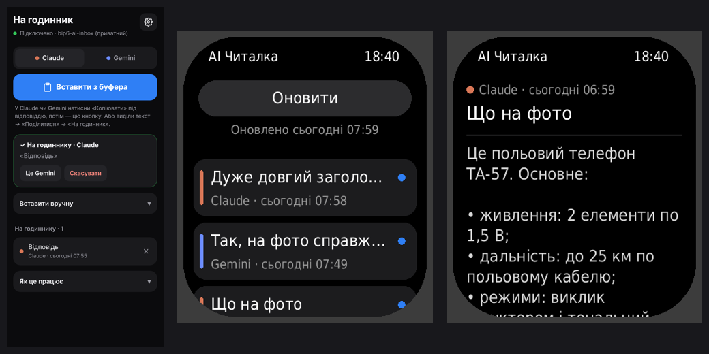

# AI Читалка — відповіді Claude і Gemini на Amazfit Bip 6

Питаєш Claude чи Gemini на телефоні — з фото, голосом, як завгодно, — а відповідь читаєш на годиннику. На годиннику нічого не набираєш.

**Як іде текст:** сторінка «На годинник» на телефоні → твій приватний репозиторій [bip6-ai-inbox](https://github.com/netherm3-coder/bip6-ai-inbox) → застосунок Zepp на телефоні → годинник.

## Налаштування (один раз)

1. **Зроби bip6-ai-inbox приватним.** [Його налаштування](https://github.com/netherm3-coder/bip6-ai-inbox/settings) → унизу Danger Zone → Change visibility → Make private. Поки він публічний, сторінка «На годинник» нічого не надсилає: інакше відповіді побачить будь-хто.
2. **Увімкни сторінку для телефона.** У цьому репозиторії: Settings → Pages → Build and deployment → Source: **GitHub Actions**. Потім Actions → Build → Run workflow. Через 1–2 хвилини сторінка відкриється тут: **https://netherm3-coder.github.io/bip6-ai-reader/**
3. **Створи токен GitHub** за [цим посиланням](https://github.com/settings/personal-access-tokens/new?name=bip6-ai&description=%D0%92%D1%96%D0%B4%D0%BF%D0%BE%D0%B2%D1%96%D0%B4%D1%96+AI+%D0%BD%D0%B0+%D0%B3%D0%BE%D0%B4%D0%B8%D0%BD%D0%BD%D0%B8%D0%BA%3A+%D0%B4%D0%BE%D1%81%D1%82%D1%83%D0%BF+%D0%BB%D0%B8%D1%88%D0%B5+%D0%B4%D0%BE+bip6-ai-inbox&expires_in=none&contents=write) (назва, термін і право Contents: Read and write уже заповнені). Сам вибери лише **Repository access → Only select repositories → bip6-ai-inbox**, далі Generate token і скопіюй `github_pat_…`. GitHub показує токен один раз.
4. **Телефон.** Відкрий сторінку з кроку 2 у **Chrome** → ⋮ → «Установити застосунок» (або «Додати на головний екран»). Відкрий «На годинник» з головного екрана → встав токен → «Зберегти й перевірити». Має з'явитися «✓ Підключено».
5. **Годинник.** Zepp → Профіль → Amazfit Bip 6 → самий низ → «Режим розробника» → кнопка сканування вгорі праворуч → відскануй QR (показати його можна з іншого екрана):

   

   Посилання в QR: `zpkd1://raw.githubusercontent.com/netherm3-coder/bip6-ai-reader/build/bip6-ai-reader.zpk`
6. **Токен у Zepp.** Zepp → Профіль → Amazfit Bip 6 → керування застосунками → «AI Читалка» → налаштування → встав той самий токен → «Перевірити зв'язок» → має бути «✓ Підключено». Назви пунктів у Zepp можуть трохи відрізнятися.

## Щодня

- У Claude чи Gemini під відповіддю натисни **«Копіювати»** → відкрий «На годинник» → **«Вставити з буфера»**. Першого разу браузер спитає дозвіл на буфер — дозволь.
- Або виділи текст → **«Поділитися»** → «На годинник». Працює, якщо сторінку встановлено через Chrome.
- На годиннику відкрий **«AI Читалка»** — список оновиться сам. Нові відповіді позначені синьою крапкою; три найновіші підвантажуються одразу, тож їх можна читати й без телефона поруч.

Перемикач Claude / Gemini на сторінці лише підписує відповідь. Якщо забув перемкнути — після надсилання є кнопка «Це Gemini» («Це Claude»).

## Що варто знати

- Передається лише текст. Розмітка (жирний, заголовки, таблиці, формули) перетворюється на простий текст; емодзі прибираються, бо шрифт годинника їх не має.
- Зберігаються останні 50 відповідей; старіші видаляються самі. Видалити вручну — хрестик у списку на сторінці «На годинник».
- На годиннику показується до 12 000 символів відповіді, на GitHub зберігається до 20 000.
- Токен лежить лише на твоєму телефоні: у браузері (сторінка «На годинник») і в Zepp. Він має доступ тільки до bip6-ai-inbox.
- Годинник оновлює список через Zepp, тому Zepp має бути запущений на телефоні, а телефон — з інтернетом.

## Як це збирається

Після кожного пушу в `main` (і раз на добу) GitHub Actions:

- збирає preview-пакет програми й кладе в гілку `build` (`bip6-ai-reader.zpk` — на нього вказує QR);
- публікує сторінку «На годинник» з папки `.pwa` на GitHub Pages.

## Структура

- `page/index.js`, `page/view.js` — список і перегляд на годиннику
- `utils/cache.js` — збережені на годиннику відповіді
- `app-side/` — сервіс у Zepp на телефоні: забирає відповіді з GitHub
- `setting/index.js` — сторінка налаштувань у Zepp (токен і репозиторій)
- `.pwa/` — сторінка «На годинник»: очищення тексту (`clean.js`) і запис у GitHub (`github.js`)
- `.tools/build-preview.js` — збірка preview-пакета для QR
