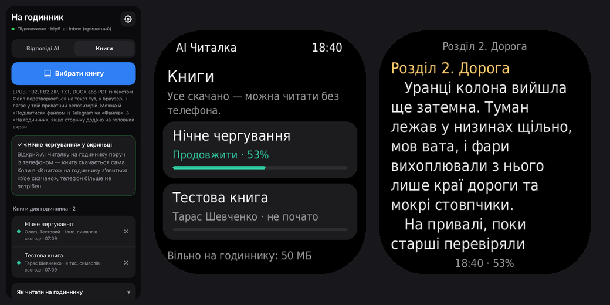

# AI Читалка — відповіді Claude і Gemini та книги на Amazfit Bip 6

Питаєш Claude чи Gemini на телефоні — з фото, голосом, як завгодно, — а відповідь читаєш на годиннику. На годиннику нічого не набираєш. А ще — книги: закачав, поки телефон поруч, і читаєш без нього.

**Як іде текст:** сторінка «На годинник» на телефоні → твій приватний репозиторій [bip6-ai-inbox](https://github.com/netherm3-coder/bip6-ai-inbox) → застосунок Zepp на телефоні → годинник.

## Налаштування (один раз)

1. **Зроби bip6-ai-inbox приватним.** [Його налаштування](https://github.com/netherm3-coder/bip6-ai-inbox/settings) → унизу Danger Zone → Change visibility → Make private. Поки він публічний, сторінка «На годинник» нічого не надсилає: інакше відповіді побачить будь-хто.
2. **Увімкни сторінку для телефона.** У цьому репозиторії (не в bip6-ai-inbox): [Settings → Pages](https://github.com/netherm3-coder/bip6-ai-reader/settings/pages) (у меню налаштувань — нижче Codespaces) → Build and deployment → Source: **GitHub Actions**. Збірка запускається після кожної зміни в репозиторії; запустити вручну — вкладка **Actions** угорі репозиторію (не в Settings) → Build → Run workflow. Через 1–2 хвилини сторінка відкриється тут: **https://netherm3-coder.github.io/bip6-ai-reader/**
3. **Створи токен GitHub** за [цим посиланням](https://github.com/settings/personal-access-tokens/new?name=bip6-ai&description=%D0%92%D1%96%D0%B4%D0%BF%D0%BE%D0%B2%D1%96%D0%B4%D1%96+AI+%D0%BD%D0%B0+%D0%B3%D0%BE%D0%B4%D0%B8%D0%BD%D0%BD%D0%B8%D0%BA%3A+%D0%B4%D0%BE%D1%81%D1%82%D1%83%D0%BF+%D0%BB%D0%B8%D1%88%D0%B5+%D0%B4%D0%BE+bip6-ai-inbox&expires_in=none&contents=write) (назва, термін і право Contents: Read and write уже заповнені). Сам вибери лише **Repository access → Only select repositories → bip6-ai-inbox**, далі Generate token і скопіюй `github_pat_…`. GitHub показує токен один раз.
4. **Телефон.** Відкрий сторінку з кроку 2 у **Chrome** → встав токен → «Зберегти й перевірити». Має з'явитися «✓ Підключено». Установлювати сторінку не обов'язково, досить закладки. Установлена (⋮ → «Додати на головний екран») ще й з'являється в меню «Поділитися».
5. **Годинник.** Zepp → Профіль → Amazfit Bip 6 → самий низ → «Режим розробника» → кнопка сканування вгорі праворуч → відскануй QR (показати його можна з іншого екрана):

   

   Посилання в QR: `zpkd1://raw.githubusercontent.com/netherm3-coder/bip6-ai-reader/build/bip6-ai-reader.zpk`
6. **Токен у Zepp.** Zepp → Профіль → Amazfit Bip 6 → керування застосунками → «AI Читалка» → налаштування → встав той самий токен → «Перевірити зв'язок» → має бути «✓ Підключено». Назви пунктів у Zepp можуть трохи відрізнятися.

## Щодня

- У Claude чи Gemini під відповіддю натисни **«Копіювати»** → відкрий «На годинник» → **«Вставити й надіслати»**. Один дотик: текст іде на годинник одразу, без підтверджень. Першого разу Chrome спитає дозвіл на буфер — «Дозволити». Не спитав — сторінка покаже, що робити.
- Без дозволу: **утримуй пунктирне поле → «Вставити»** (або торкнись скопійованого тексту над клавіатурою) — теж іде одразу.
- Той самий текст двічі поспіль (протягом 90 с) не надсилається — захист від подвійного дотику.
- Або виділи текст → **«Поділитися»** → «На годинник». Працює, якщо сторінку встановлено через Chrome.
- На годиннику відкрий **«AI Читалка»** — список оновиться сам. Нові відповіді позначені синьою крапкою; три найновіші підвантажуються одразу, тож їх можна читати й без телефона поруч.

Перемикач Claude / Gemini на сторінці лише підписує відповідь. Якщо забув перемкнути — після надсилання є кнопка «Це Gemini» («Це Claude»).

## Книги

1. **Надіслати.** Сторінка «На годинник» → вкладка **«Книги»** → «Вибрати книгу» → перевір назву й автора → «Надіслати». Або в Telegram чи «Файлах» «Поділитися» файлом книги → «На годинник» (якщо сторінку додано на головний екран). Підходять EPUB, FB2, FB2.ZIP, TXT (UTF-8 чи Windows-1251), DOCX і PDF із текстом. Файл перетворюється на текст тут-таки, у браузері, і лягає в той самий приватний bip6-ai-inbox (папка `books`).
2. **Закачати.** Відкрий AI Читалку на годиннику поруч із телефоном — нові книги качаються самі, на кнопці «Книги» видно відсотки. Поки «Книги» на годиннику відкриті, щойно надіслана книга з'являється за хвилину. Коли там написано **«Усе скачано»**, телефон більше не потрібен.
3. **Читати.** Торкнись праворуч — наступна сторінка, ліворуч — попередня; свайп угору чи вниз — те саме. Торкнись назви розділу вгорі чи рядка внизу — меню: зміст, шрифт (24 / 28 / 32), перехід на ±10 %, жест руки, видалення з годинника.

- Книги окремо від відповідей: у списку відповідей — лише кнопка «Книги». У «Книгах» та, що читаєш, перша — «Продовжити · N %».
- Місце запам'ятовується на кожній сторінці.
- **Без телефона поруч**, якщо востаннє читав книгу, програма відкривається одразу на ній (свайп праворуч — «Книги», ще раз — відповіді). Якщо востаннє читав відповіді — відкриваються вони.
- Поки читаєш, екран не гасне, навіть коли опускаєш руку (у меню можна ввімкнути, щоб гаснув). Після 5 хв без дотиків гасне сам; піднімеш руку — та сама сторінка.
- Недокачана книга читається до місця, де обірвалось (у рядку внизу видно «скачано N %»), і докачується сама, щойно телефон знову поруч.
- Видалена з годинника книга лишається у скриньці: у «Книгах» на годиннику торкнись її, щоб скачати знову. Зі скриньки — хрестик на вкладці «Книги».

## Що варто знати

- Передається лише текст. Розмітка (жирний, заголовки, таблиці, формули) перетворюється на простий текст; емодзі прибираються, бо шрифт годинника їх не має.
- Зберігаються останні 50 відповідей; старіші видаляються самі. Видалити вручну — хрестик у списку на сторінці «На годинник».
- На годиннику показується до 12 000 символів відповіді, на GitHub зберігається до 20 000.
- Поки «AI Читалка» відкрита, екран годинника не гасне ні сам, ні коли опускаєш руку. Запобіжник для батареї: після 20 хв без жодного дотику згасне. Після виходу з програми все як було.
- Токен лежить лише на твоєму телефоні: у браузері (сторінка «На годинник») і в Zepp. Він має доступ тільки до bip6-ai-inbox.
- Годинник оновлює список через Zepp, тому Zepp має бути запущений на телефоні, а телефон — з інтернетом.
- Книги — лише текст: без картинок і форматування; заголовки розділів виділено кольором, посилання на примітки — `[1]`, примітки FB2 — наприкінці.
- Не відкриються PDF-скани (без текстового шару) і EPUB із захистом від копіювання (DRM); старий `.doc` треба зберегти як DOCX. Книга — до 4 млн символів.
- Швидкість передачі книги через Bluetooth на самому годиннику ще не міряна; орієнтовно звичайний роман качається кілька хвилин. Головне — дочекатися «Усе скачано».
- Якщо в шрифті годинника немає знаків « » — …, вони показуються простими " - ...

## Як це збирається

Після кожного пушу в `main` (і раз на добу) GitHub Actions:

- збирає preview-пакет програми й кладе в гілку `build` (`bip6-ai-reader.zpk` — на нього вказує QR);
- публікує сторінку «На годинник» з папки `.pwa` на GitHub Pages.

## Структура

- `page/index.js`, `page/view.js` — список і перегляд відповідей на годиннику
- `page/books.js`, `page/read.js`, `page/bookmenu.js`, `page/toc.js` — бібліотека, читалка, меню книги, зміст
- `utils/cache.js` — збережені на годиннику відповіді
- `utils/books.js` — книги на годиннику; `utils/layout.js` — розбиття на рядки й сторінки; `utils/booksync.js` — завантаження з телефона
- `app-side/` — сервіс у Zepp на телефоні: забирає відповіді й книги з GitHub
- `setting/index.js` — сторінка налаштувань у Zepp (токен і репозиторій)
- `.pwa/` — сторінка «На годинник»: очищення тексту (`clean.js`), запис у GitHub (`github.js`), книги (`books-ui.js`, `convert/` — EPUB, FB2, TXT, DOCX, PDF → текст; `vendor/` — fflate і pdf.js)
- `.tools/build-preview.js` — збірка preview-пакета для QR
